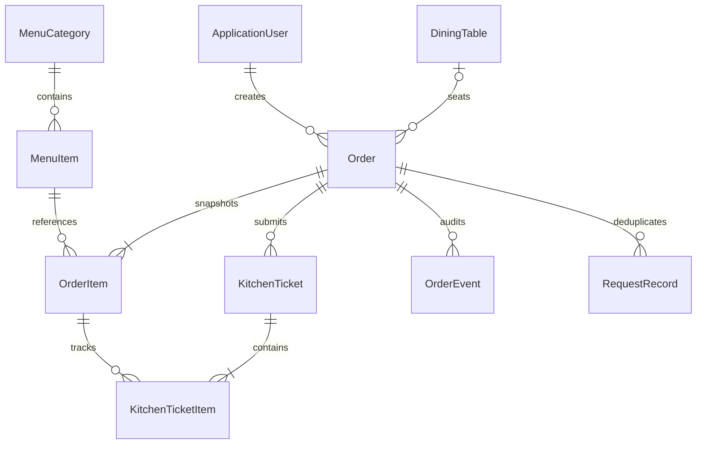
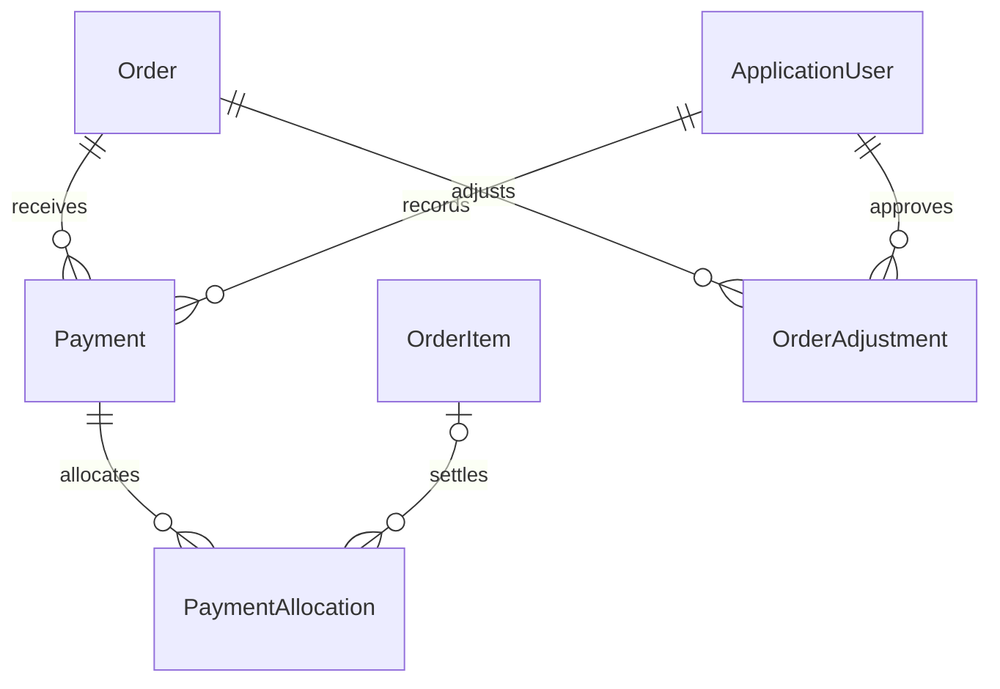

# Database design

Solid entities below exist in the first migration (Identity's supporting tables omitted).

Unique indexes: table Number, order OrderNumber, ticket TicketNumber; partial unique Order.TableId where non-null and Status != Closed. Thus a closed order releases its table without deleting history. FK constraints protect menu/table/order references. Orders and tables have application-managed integer Version concurrency tokens. Writes take SQLite's immediate writer transaction before checks. Busy timeout is 15 seconds, WAL enabled at startup. Pending financial writes must use the same transaction discipline.

Menu Price and order UnitPriceSnapshot are C# decimals converted to integer sen in SQLite. Supported prices have two decimal places. No floating-point storage or arithmetic. Bill sums snapshot price × (quantity − cancelled quantity) in decimal C#. Changes to menu prices do not rewrite history. Quantity and cancellation checks also exist in SQLite. Kitchen ticket original quantities remain immutable; cancellations are visible through the linked order item and audited reason.

## Planned financial extension (not migrated yet)

Payment needs unique actor-scoped idempotency key, method/status, amount, received UTC, reference, explicit tender/change, and refund audit links. Allocation totals must equal recorded payment; allocated item quantities cannot exceed uncancelled quantities. Received amounts cannot exceed balance. Only zero-balance orders may close. Adjustments require signed decimal amounts and reasons. RestaurantSettings will store receipt details, currency, timezone and cutoff. Reports must separately show ordered value, discounts, completed collections, refunds and outstanding balances; snapshot prices remain authoritative. These invariants and timezone/cutoff reporting tests remain pending.
