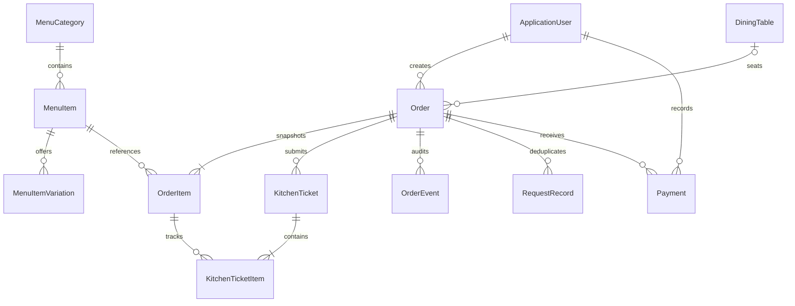
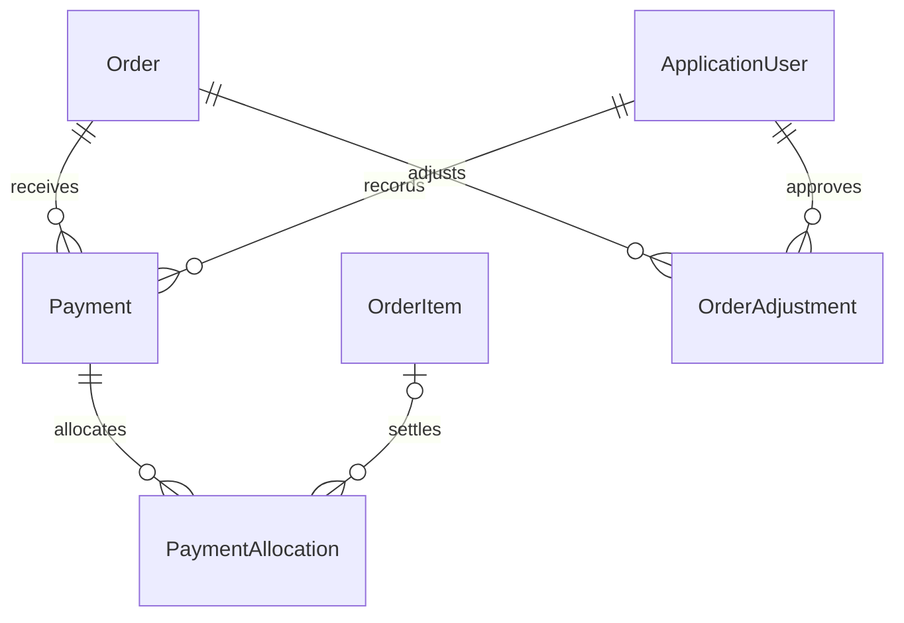

# Database design

Implemented entities across the checked-in migrations (Identity's supporting tables omitted).

Unique indexes: table Number, order OrderNumber, ticket TicketNumber; partial unique Order.TableId where non-null and Status != Closed. Thus a closed order releases its table without deleting history. FK constraints protect menu/table/order references. Orders and tables have application-managed integer Version concurrency tokens. Writes take SQLite's immediate writer transaction before checks. Busy timeout is 15 seconds, WAL enabled at startup. Pending financial writes must use the same transaction discipline.

DailyNumbersAndOrderWorkflow adds Order.BusinessDate and Order.DailyNumber, with a unique filtered index on (BusinessDate, DailyNumber) for positive sequences. The read-only DisplayNumber is formatted as #0001 and is not a replacement for the GUID or original long OrderNumber. Existing orders are backfilled by UTC creation timestamp converted to Malaysian date (+08:00), ordered by timestamp/ID. New numbers are allocated under an immediate writer transaction, so concurrent creates cannot share a number. All orders, including closed/cancelled and development seed orders, retain their daily number. No counters/IDs are reset by checkout or undo.

KitchenTicketItem.CancellationReason stores the latest reason for visible kitchen reconciliation; OrderEvent preserves every cancellation with actor, quantities and reason. Batch cancellation changes all selected lines and their ticket state in one transaction, or rolls the entire operation back.

Open → AwaitingPayment is the waiter checkout handoff. AwaitingPayment → Open is allowed only before payment. Both keep the table occupied. Payment settlement requires AwaitingPayment and closes the order atomically; the table becomes free only then. Paid/closed orders cannot be edited or undone. Aggregate outstanding totals remain derivable from snapshots and payment records even though the aggregate is hidden in the UI.

Menu Price and order UnitPriceSnapshot are C# decimals converted to integer sen in SQLite. Supported prices have two decimal places. No floating-point storage or arithmetic. Bill sums snapshot price × (quantity − cancelled quantity) in decimal C#. Changes to menu prices do not rewrite history. Quantity and cancellation checks also exist in SQLite. Kitchen ticket original quantities remain immutable; cancellations are visible through the linked order item and audited reason.

The additive `MenuVariations` migration introduces MenuItemVariation (Id, MenuItemId, Name, AdditionalPrice, IsAvailable, SortOrder). AdditionalPrice is a nonnegative integer-sen decimal conversion, with a unique (MenuItemId, Name) index and FK to MenuItem. Ordering validates variation ownership and availability within the same writer transaction. Selected variation text is preserved in ItemNameSnapshot and the extra charge in UnitPriceSnapshot, so changing/deleting a variation does not alter old tickets, bills or cancellation accounting. Different variations remain distinct order lines.

## Checkout payment persistence

The additive CheckoutPayments migration creates completed Payment records with order/actor foreign keys, a unique actor-scoped idempotency key, decimal amounts mapped to integer sen, method, UTC timestamp, reference, tender and change. Database checks enforce positive recorded amount, tender >= amount, change = tender - amount, a valid method, and zero change for non-cash payments. Checkout validates the exact current balance inside the writer transaction before recording payment and setting Closed. Zero-balance closure records no payment. Requests and audit events commit with the payment; notifications publish afterward. Paid orders cannot be edited/cancelled; refunds require a later authorized workflow.

## Planned financial extension (allocations/adjustments/refunds not migrated yet)

Payment currently represents completed collections only. Pending extensions need payment lifecycle/status and refund audit links. Allocation totals must equal recorded payment; allocated item quantities cannot exceed uncancelled quantities. Only zero-balance orders may close. Adjustments require signed decimal amounts and reasons. RestaurantSettings will store receipt details, currency, timezone and cutoff. Reports must separately show ordered value, discounts, completed collections, refunds and outstanding balances; snapshot prices remain authoritative. Allocation/adjustment/refund invariants and timezone/cutoff reporting tests remain pending.

PaymentAllocation links Payment to OrderItem with paid Quantity and Amount (integer sen). Unique (PaymentId, OrderItemId); foreign keys restrict deletion. Original order lines remain intact for the consolidated receipt.
